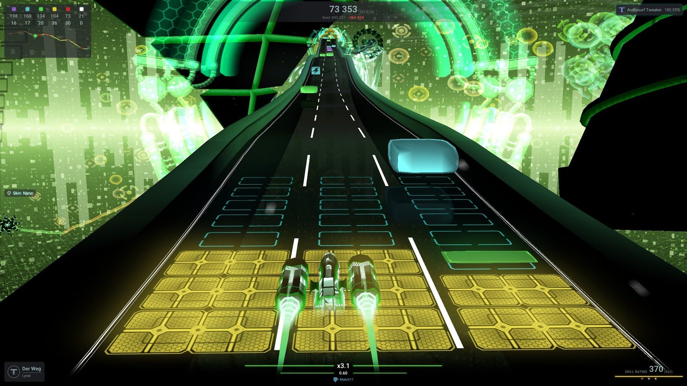
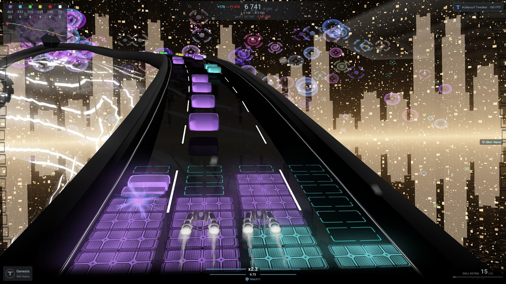
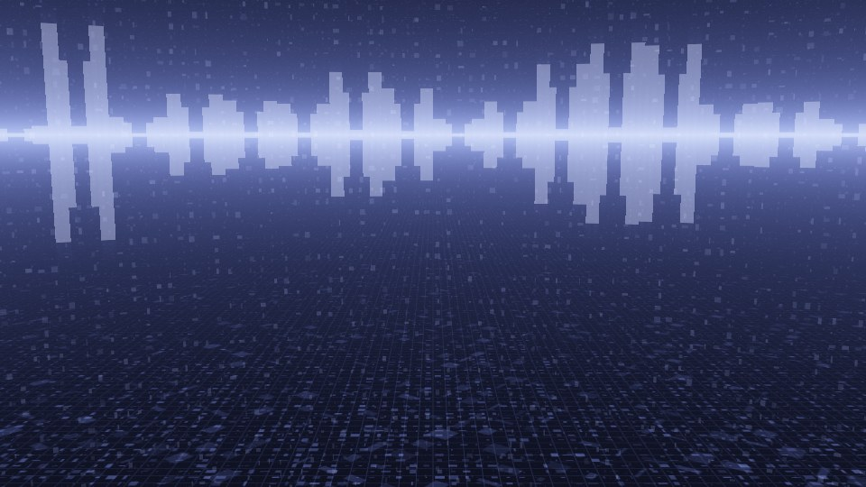
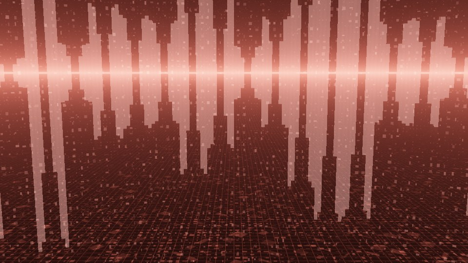
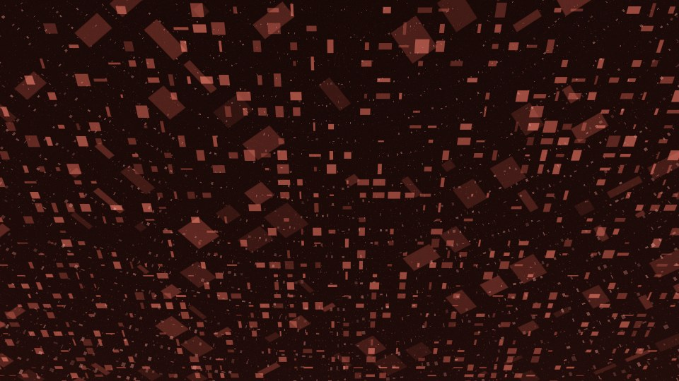

# Nano Neon

An electronic sky for **Audiosurf 1**, in the spirit of Audiosurf 2's *substratum / the grid* skins:
a dark void, a neon horizon, an analyser standing on it as a ring of columns, a plan view below and
the same grain overhead.

A [Tweaker](https://github.com/Audiosurf-Tweaker/Audiosurf-Tweaker) sky package. One fullsky shader,
no textures, no geometry.





*Gameplay at 2560×1440, downscaled. The track, blocks, vehicles and the HUD belong to the game; the
sky behind them is this package.*

The shader on its own, with no track in the way — the same maths the plugin runs, rendered on the CPU
so a change can be seen without launching the game:

| calm | loud | looking up |
|---|---|---|
|  |  |  |

## Install

Drop the folder, or a zip of it, into

```
Audiosurf\engine\TweakerStuff\SkyboxReplacer\Skyboxes\
```

and pick **Nano Neon** in the Skybox tab of the in-game overlay. Saving anything in that tab rebuilds
the shader, so an edit is one Ctrl+S away.

Requires the Tweaker build with `SkyboxReplacer`. No other packages, no textures to ship.

## What it draws

Six layers, composed in one `ps_3_0` pass:

| | |
|---|---|
| **Void and haze** | the deep colour is the neon at a few percent, never a second hue |
| **Horizon** | a measured band, plus a narrow crest on the line itself |
| **Analyser** | columns standing on the horizon, height driven by the spectrum, drawn as a backlight and a bar |
| **Plan view** | a grid converging on the vanishing point, plus the fine rectangular grain the reference floor is made of |
| **Ceiling** | the same grain in the plane above the player |
| **Particles** | a drifting field of square chips, three shells at different rates |

Nothing rotates by default. The game's camera rotates constantly on its own, and a sky that adds to
that reads as a mistake rather than as motion.

## Knobs

Ten groups in the Skybox tab, plus eight shared values at the top:

- **Colour** — void depth
- **Palette** *(shared)* — the two ends of the hue arc, the window, gain, curve, minimum heat, which
  way round the circle, saturation
- **Horizon**, **Towers**, **Floor**, **Mosaic**, **Ceiling**, **Particles**, **Spectrum**, **Master**,
  **Debug**

The defaults are not invented: they are the values the author ended up with after flying the sky, so
they are the one set that has been seen working. `design/nano-neon-architecture.md` records what each
one does, why the ranges are what they are, and which of them are known to be awkward — the eighth
section is an honest audit of the knobs, including the ones that are pinned at a range limit or have
a cliff in the middle of the slider.

## Building

The shader is compiled by the plugin at run time from `shaders/sky.hlsl`, with the Tweaker's own
`sky_common.hlsli` on the include path. To compile it by hand:

```
fxc /T ps_3_0 /E main /I <Tweaker>/Docs/skyboxes/include shaders/sky.hlsl
```

`fxc` warns about nothing and the listing is ~900 instruction slots.

## Why a separate repository

Each sky is its own product with its own history and its own release. The
[Skyboxes](https://github.com/Audiosurf-Tweaker/Skyboxes) repository pins the versions that ship, so
one sky can be updated without rewriting the others.

## Licence

MIT, see [LICENSE](LICENSE).
